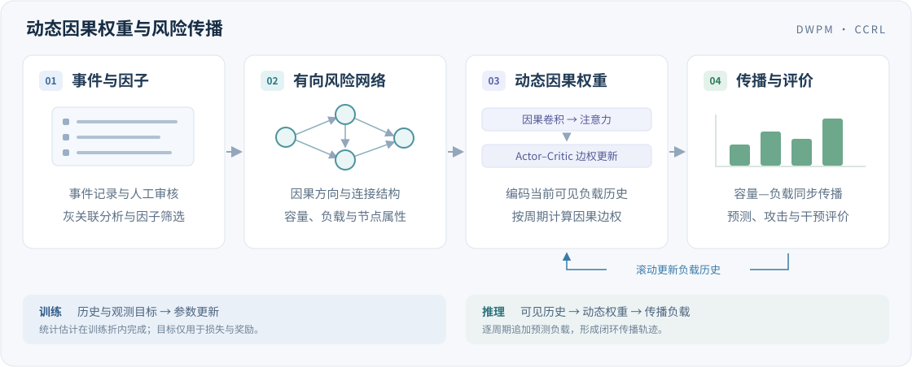

<div align="center">

<p><strong>DWPM · 2026</strong></p>

<h1>Dynamic causal weighting-based risk propagation modeling for airport movement areas</h1>

<p><strong>机场飞行区动态因果权重与风险传播模型</strong></p>

<p><em>Scientific Reports</em> <strong>16</strong>, 5249 (2026)</p>

<p>
  <a href="https://doi.org/10.1038/s41598-026-36059-3"></a>
  
  
</p>

<p>
  <a href="https://www.nature.com/articles/s41598-026-36059-3">📄 论文</a> ·
  <a href="#quick-start">🚀 快速开始</a> ·
  <a href="docs/QUICKSTART.md">📖 使用指南</a> ·
  <a href="#citation">📚 引用</a>
</p>

</div>

本项目提供机场飞行区风险因素提取、训练域因果网络构建、动态边权学习、容量负载传播及实验评价代码。核心模型结合因果时间卷积、图注意力与 Actor–Critic 权重更新，支持逐周期闭环预测和节点干预分析。

<a id="highlights"></a>

## ✨ Highlights

- **事件到网络**：事件表读取、规则与语义角色标注接口、专家审核、灰关联筛选和有向因果网络构建。
- **动态风险传播**：因果卷积与注意力编码历史，Actor–Critic 调整边权，统一计算容量、激活、阻抗及 NRI／SRI／NDI 指标。
- **实验与复现**：DWPM、NDWPM、DBN、VAR、T-GNN 对照，顺序消融、敏感性、动态／冻结权重的攻击和干预；支持事件级划分、训练折建网、检查点续训及中文图表。

<a id="framework"></a>

## 🧩 Method Overview



模型与传播操作定义见[模型说明](docs/MODEL.md)，公式 1–26 的代码对应见[公式映射](docs/FORMULA_MAP.md)。

<a id="quick-start"></a>

## 🚀 Installation

需要 **Python 3.11+**，支持 CPU 运行。在仓库根目录执行：

```bash
python -m pip install -e '.[test,xlsx]'
python -m airport_risk --help
python -m pytest -q
```

中文图表需要 Noto Sans CJK SC、思源黑体、苹方或微软雅黑。HanLP 为可选本地 SRL 后端；环境与模型资源配置见[使用指南](docs/QUICKSTART.md#installation)。

<a id="dataset"></a>

## 🗂️ Dataset

论文研究数据包含 2008–2021 年 2,795 条 FAA／CAAC 飞行区不安全事件。**原始事件记录、审核标注、负载序列和训练权重不随源码分发**，运行时由使用者提供经授权的私有材料。

| 输入 | 用途 |
|---|---|
| 逐节点负载观测 | 使用带时间戳的负载长表构建下一时刻与轨迹预测样本 |
| 经审核的因果链或阶段标注 | 构建因果阶段样本，评价下一标注阶段的预测能力 |

两类输入分别保存时间轴、单位与来源。准备步骤见[使用指南](docs/QUICKSTART.md#data-preparation)，字段规范见[数据契约](docs/DATA_CONTRACT.md)。

<a id="project-structure"></a>

## 📁 Project Structure

```text
├── src/airport_risk/
│   ├── record_input.py       # 事件表导入与字段审计
│   ├── nlp.py                # 因果候选、SRL 与审核协议
│   ├── text_mining.py        # 文本特征与主题聚类
│   ├── preparation.py        # 观测／阶段样本构建
│   ├── data.py               # 数据契约与事件级划分
│   ├── network.py            # 因子筛选、建网、容量与阻抗
│   ├── core.py               # 传播公式与风险指标
│   ├── models.py             # CCRL 与时序图模型
│   ├── baselines.py          # 静态传播、DBN 与 VAR
│   ├── relations.py          # 节点关系与运行上下文
│   ├── experiments.py        # 预测、消融与敏感性实验
│   ├── dynamic.py            # 动态攻击与节点干预
│   ├── reporting.py          # 评价报告与中文图表
│   └── cli.py                # 命令行入口
├── configs/                  # 候选因子、训练参数与实验协议
├── docs/                     # 方法、数据和使用文档
├── tests/                    # 数值、模型与接口测试
├── CITATION.cff              # 论文引用元数据
└── references.bib            # BibTeX
```

<a id="train-evaluate"></a>

## ⚙️ Train & Evaluate

准备私有 `RiskData` 文件后，检查配置并执行实验：

```bash
python -m airport_risk check \
  --config configs/default.json --data data/private/risk.npz
python -m airport_risk run \
  --config configs/default.json --data data/private/risk.npz \
  --out runs/experiment-001
```

`configs/default.json` 默认按年份对事件组分层，启用五种模型、消融、敏感性、攻击和干预。`configs/paper_protocols.json` 提供额外比例、滚动年份和北京首都机场留出协议，需匹配输入数据的年份与机场覆盖范围。

输出包含配置与来源摘要、数据划分、训练折网络、预测指标、权重与负载轨迹、检查点和中文图表。单模型训练、断点续训、下一时刻推理及闭环预测命令见[使用指南](docs/QUICKSTART.md#train-evaluate)。

<a id="documentation"></a>

## 📖 Documentation

| 文档 | 内容 |
|---|---|
| [使用指南](docs/QUICKSTART.md) | 安装、数据准备、训练、续训与推理 |
| [数据契约](docs/DATA_CONTRACT.md) | 数组形状、窗口、分组、时间轴与单位 |
| [事件表读取](docs/INPUT_RECORDS.md) | 原始字段、日期和因果候选审核 |
| [文本与网络](docs/TEXT_NETWORK.md) | 因子目录、SRL、训练域建网、容量与阻抗 |
| [模型说明](docs/MODEL.md) | CCRL、关系算子、基线与检查点 |
| [实验协议](docs/EXPERIMENTS.md) | 评价指标、消融、敏感性与干预 |
| [公式映射](docs/FORMULA_MAP.md) | 公式 1–26 的计算定义与对应模块 |
| [论文规格](docs/PAPER_SPEC.md) | 发表版本的方法与报告表格 |
| [论文机场](docs/PAPER_AIRPORTS.md) | 论文提及机场及其研究用途 |
| [参考项目](docs/REUSE.md) | 相关结构、接口与许可来源 |

<a id="citation"></a>

## 📚 Citation

相关研究请引用论文：

```bibtex
@article{wu2026dynamic,
  title={Dynamic causal weighting-based risk propagation modeling for airport movement areas},
  author={Wu, Wei and Lin, Jiayi and Wei, Ming and Wang, Xinglong and Zhu, Longfei},
  journal={Scientific Reports},
  volume={16},
  pages={5249},
  year={2026},
  doi={10.1038/s41598-026-36059-3}
}
```

引用元数据：[CITATION.cff](CITATION.cff) · [references.bib](references.bib)。代码许可证状态见 [LICENSE-NOTICE.md](LICENSE-NOTICE.md)，依赖与来源见 [THIRD_PARTY.md](THIRD_PARTY.md)。
